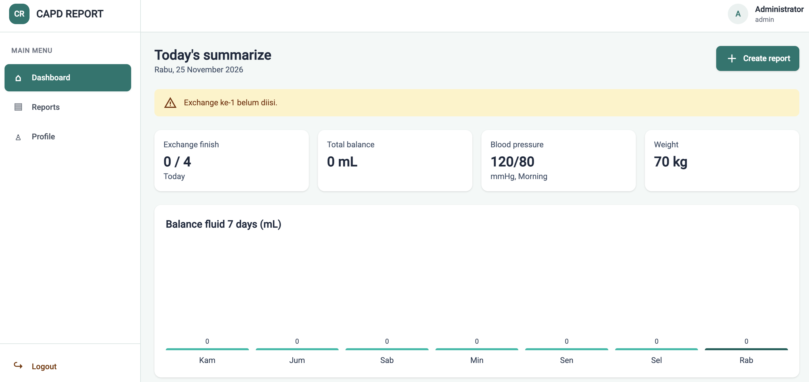
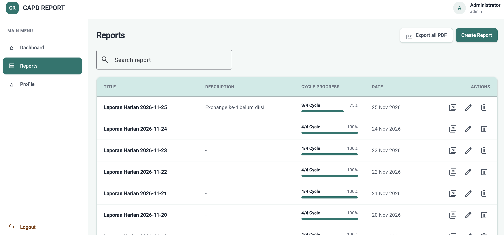
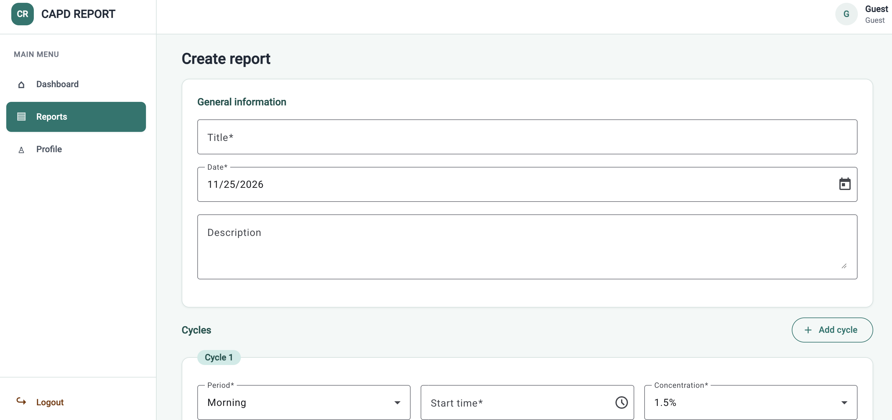
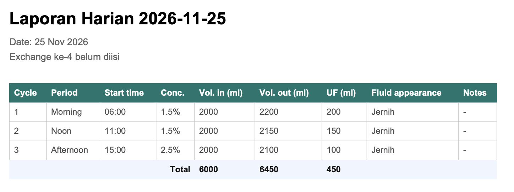
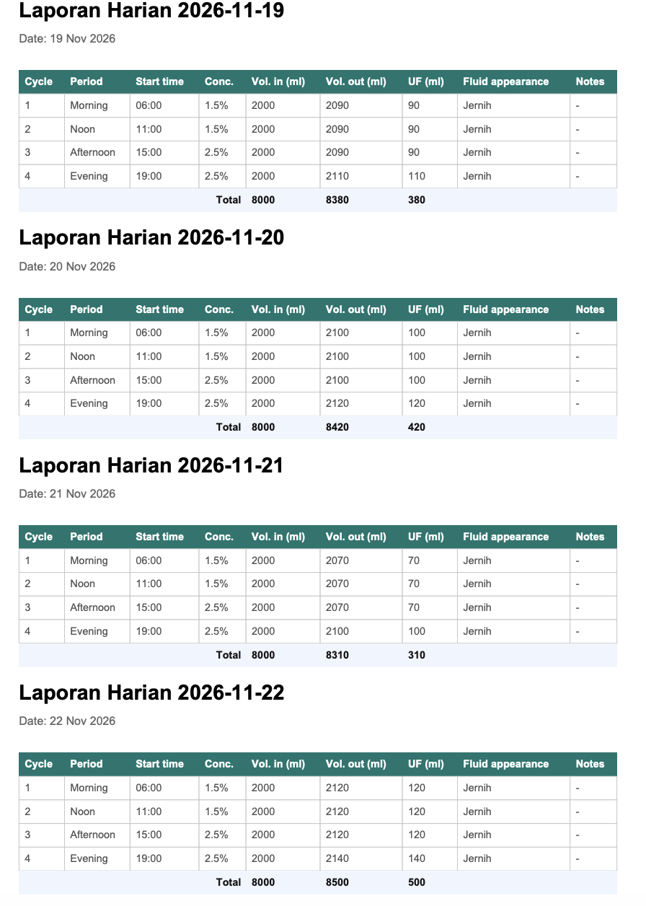

# CAPD REPORT

A web application that helps nurses record, review, and export patient **CAPD (Continuous Ambulatory Peritoneal Dialysis)** reports. Instead of going through paper notes, nurses can check a patient's daily, weekly, or monthly progress in one place and export it as a PDF.

## Purpose

Nurses need a fast and reliable way to follow how a patient is doing on CAPD over time. This app makes that easier by:

- Recording each day's exchange cycles (volume in, volume out, UF, fluid appearance, notes).
- Calculating totals and ultrafiltration (UF) automatically.
- Letting nurses review reports per day, or merge many days into one document for weekly or monthly review.
- Keeping patient data behind a secure login.

## Tech Stack

| Area        | Technology                                  |
| ----------- | ------------------------------------------- |
| Framework   | Angular 22 (standalone components, signals) |
| UI          | Angular Material                            |
| Styling     | Tailwind CSS                                |
| Forms       | Angular Reactive Forms (typed)              |
| PDF export  | jsPDF + jsPDF-AutoTable                     |
| Auth        | JWT-based login with route protection       |

## Modules

### 1. Dashboard

The landing page after login. It gives nurses a quick overview of report activity and fast access to the other modules.

### 2. Report

The core module.

- **Report list**: searchable table (desktop) and card view (mobile) with title, description, cycle progress (x/4 cycles), and date.
- **Create / edit report**: a form with general information (title, date, description) and a dynamic list of cycles.
  - Each cycle has period (Morning, Noon, Afternoon, Evening), start time, concentration (1.5%, 2.5%, 4.25%), volume in, volume out, fluid appearance, and notes.
  - UF per cycle and report totals are calculated live.
  - Unsaved-changes guard prevents accidental data loss.
- **Delete report** with confirmation.

### 3. Profile

Account page for the logged-in user.

## Features

- **Export PDF (daily)**: export a single report with its header, full cycle table, and totals.
- **Export PDF (all)**: export every report as one continuous document. Reports follow each other in date order and flow onto the next page only when the current one is full.
- **Login and security**: users must sign in to access the app. Protected routes redirect unauthenticated users to the login page, and API requests carry a JWT token.
- **Responsive layout**: works on desktop, tablet, and phone.
- **Search**: filter reports by title with debounced input.

## Screenshots

### Dashboard


### Report
| List | Form |
| --- | --- |
|  |  |

### PDF Export
| Daily | All |
| --- | --- |
|  |  |

## Getting Started

### Prerequisites

- Node.js (a version supported by Angular 22)
- npm
- The backend REST API running and reachable from the frontend

### Install

```bash
npm install
```

### Run in development

```bash
ng serve
```

Open `http://localhost:4200`.

### Build for production

```bash
ng build
```

## PDF Export Usage

| Action          | Where                                  | Result                                               |
| --------------- | -------------------------------------- | ---------------------------------------------------- |
| Export daily    | PDF icon on a report row or card       | One PDF containing that day's full report            |
| Export all      | "Export all PDF" button in list header | One PDF with all listed reports, merged in date order |

Note: "Export all" uses the reports currently shown in the list, so a search filter also narrows the export.
